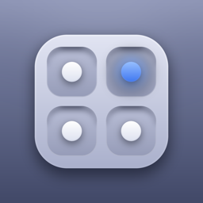

<div align="center">



# iContain

**Run apps inside one app on your iPhone, including builds made for the iOS Simulator.**

[](https://github.com/mirazbakis/iContain/actions/workflows/ci.yml)
[](https://github.com/mirazbakis/iContain/releases)
[](#requirements)
[](LICENSE)

</div>

> [!NOTE]
> iContain is early (0.x). It has been tested in the iOS Simulator; testing on real devices is in progress. Expect rough edges, and please [report what breaks](https://github.com/mirazbakis/iContain/issues/new/choose).

## What it does

iContain loads an imported app's code into its own process and gives it its own data folder, so the app runs **without being installed on iOS**. Every app in iContain shares iContain's one App ID, so a free Apple ID's limits don't apply to them.

It's built for testing apps on a real device:

| | |
| :-- | :-- |
| **Simulator builds on iPhone** | Import a `.app` built for the iOS Simulator. iContain converts it to run on the device. |
| **Any build** | `.ipa`, `.xcarchive` or a zipped `.app`, from Files, the share sheet, or iContain's folder in the Files app |
| **Test mode** | Run an app as another device: iPhone SE to iPhone 17 Pro Max, iPad mini to iPad Pro. Screen size, safe areas, iPhone or iPad layout, and light or dark mode, shown in a device frame. |
| **Simulated location** | Pick a place on the map. Apps in iContain see it with no setup. With [LocalDevVPN](https://apps.apple.com/app/id6755608044) and a pairing file, move the whole iPhone's location too. |
| **More RAM** | Turn on the Increased Memory Limit and Extended Virtual Addressing for your App IDs (iContain's own included, which covers every app inside it). |
| **Signing** | With your Apple ID (same anisette servers and Automatic mode as [AltLoad](https://github.com/mirazbakis/AltLoad)) or a development certificate file (`.p12`) |
| **Shortcuts-friendly** | `icontain://open?app=<name>` opens an app; `icontain://import-inbox` imports everything in iContain's folder |

## Requirements

- iOS 18 or later. The Liquid Glass design needs iOS 26; earlier versions get a frosted look.
- A way to sideload iContain itself, such as [AltLoad](https://github.com/mirazbakis/AltLoad), AltStore or SideStore
- An Apple ID (a free one works), or a `.p12` development certificate **from the same team as the certificate iContain is signed with**
- For device-wide location only: Developer Mode, LocalDevVPN, and this iPhone's RemotePairing file

## Install

1. Download `iContain.ipa` from [Releases](https://github.com/mirazbakis/iContain/releases), or the [nightly build](https://github.com/mirazbakis/iContain/releases/tag/nightly).
2. Install it with AltLoad, AltStore or SideStore.
3. Open iContain, sign in under **Account** (or use a certificate file), and import an app.

### Opening an app

Opening an app takes you to the Home Screen for a moment: tap the **"… is ready"** notification, or the iContain icon, and the app starts. To get back to iContain, close the app from the app switcher and open iContain again.

## What doesn't work yet

- App extensions, widgets, push notifications and running two apps at once
- The Keychain, for apps that rely on their own Keychain access group
- App Store apps unless they're decrypted (they're FairPlay-encrypted)
- Booting other iOS versions (full Simulator runtimes): planned, see [docs/ARCHITECTURE.md](docs/ARCHITECTURE.md#roadmap)

## Build it yourself

You need Xcode 26 or later, [Rust](https://rustup.rs) and [XcodeGen](https://github.com/yonaskolb/XcodeGen).

```bash
rustup target add aarch64-apple-ios aarch64-apple-ios-sim
brew install xcodegen
./scripts/build-rust.sh      # Rust core → iContainFFI.xcframework
xcodegen generate            # project.yml → iContain.xcodeproj
open iContain.xcodeproj
```

Run the end-to-end check in the Simulator (builds everything, imports the Probe test app, opens it and checks the loader):

```bash
./scripts/test-sim.sh
DEVICE=iphone-se APPEARANCE=dark LAT=48.8584 LON=2.2945 ./scripts/test-sim.sh
```

How the pieces fit together, and how to add features, is in [docs/ARCHITECTURE.md](docs/ARCHITECTURE.md).

## Releases

Releases are built by GitHub Actions: **Actions › Build IPA › Run workflow**.

- **Build only** uploads `iContain.ipa` as an artifact.
- **Release** publishes `vX.Y.Z` with the notes in `docs/releases/vX.Y.Z.md`. Bump `MARKETING_VERSION` in `project.yml` first.
- **Nightly** replaces the `nightly` prerelease.

## License

iContain is [MIT-licensed](LICENSE). It's built with [idevice](https://github.com/jkcoxson/idevice) and [isideload](https://github.com/nab138/isideload) (MIT) and apple-codesign-quick (LGPL-2.1-or-later); see [THIRD_PARTY_NOTICES.md](THIRD_PARTY_NOTICES.md).

iContain's loader is its own implementation. It uses the same publicly documented technique as [LiveContainer](https://github.com/LiveContainer/LiveContainer), loading an app's executable as a library inside a host app, but doesn't include LiveContainer's code.

iContain isn't affiliated with Apple. Only use it with apps you have the right to run.
